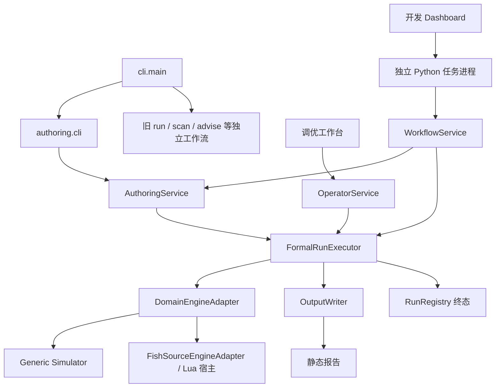

# IGESS 平台层 Code Walkthrough

本文供平台开发、问题定位和新引擎接入时查阅。依据 2026-10-28 工作区源码编写，描述已实现的调用关系，不将规划文档视为实现。入口、协议或产物变更时，应同步更新对应章节。

## 1. 范围与阅读路线

IGESS 平台负责模型输入、校验与构建、增量编辑事务、引擎调度、正式运行、产物、报告、历史和执行工具包交付。Generic 经济模拟是内置引擎；Fish 的领域规则与 Lua 宿主只在本文中说明接入边界。

执行模拟或分析的 Agent 从根 [AGENTS.md](../AGENTS.md) 进入 [模拟执行接口](agents/simulation-interfaces.md)，按任务选择现有 CLI。该索引说明调用、影响与结果检查；本文供开发和扩展平台时定位实现，领域 Skill 负责业务规则与调优决策。

先读 [CONTEXT.md](../CONTEXT.md) 统一术语，再按下面顺序阅读代码：

1. [schema.py](../src/igess/schema.py)：输入、模型、状态、事件和结果的数据结构。
2. [engines.py](../src/igess/engines.py)：平台与领域引擎之间的协议。
3. [formal_run.py](../src/igess/formal_run.py)：一次正式运行的共同执行顺序。
4. [authoring/service.py](../src/igess/authoring/service.py) 与 [workflows.py](../src/igess/workflows.py)：谁准备输入、登记运行、处理响应。
5. [outputs.py](../src/igess/outputs.py)、[run_registry.py](../src/igess/run_registry.py) 和 [reporting/static.py](../src/igess/reporting/static.py)：结果如何落盘和展示。
6. 按任务继续读增量编辑、Dashboard 或执行工具包章节。

Fish 新模拟、规则与调优统一进入 [projects/fish_source](../projects/fish_source/README.md)，当前范围见其 [RoadMap](../projects/fish_source/RoadMap.md)。`projects/fish` 已停用；`src/igess/fish_*.py` 中仍有旧 Python 引擎兼容实现，文件存在不代表应继续在该后端开发新规则。

## 2. 代码地图

平台目前是一个 Python 包，主要模块直接位于 `src/igess/`，并非已拆分为独立服务。下表按职责分组，不代表物理包边界。

| 职责 | 代码入口 | 主要责任 |
| --- | --- | --- |
| 命令行 | [cli.py](../src/igess/cli.py)、[cli_support.py](../src/igess/cli_support.py)、[authoring/cli.py](../src/igess/authoring/cli.py) | 参数解析、分派、响应与退出码 |
| 输入与模型 | [loader.py](../src/igess/loader.py)、[linter.py](../src/igess/linter.py)、[builder.py](../src/igess/builder.py)、[schema.py](../src/igess/schema.py) | YAML/JSON 到已校验运行模型 |
| 数值与表达式 | [numbers.py](../src/igess/numbers.py)、[formula.py](../src/igess/formula.py)、[conditions.py](../src/igess/conditions.py) | `SimNumber`、受限 AST 公式和条件计算 |
| Generic 引擎 | [simulator.py](../src/igess/simulator.py)、[time_engine.py](../src/igess/time_engine.py)、[policy.py](../src/igess/policy.py)、[modifiers.py](../src/igess/modifiers.py) | 时间推进、行为选择、产出和修饰器 |
| 模型编辑 | [authoring/](../src/igess/authoring/) | 源文件映射、候选导表、锁、事务、审计、就绪检查 |
| 正式运行 | [engines.py](../src/igess/engines.py)、[formal_run.py](../src/igess/formal_run.py)、[workflows.py](../src/igess/workflows.py) | 引擎适配、共同生命周期与开发工作流 |
| 历史与诊断 | [run_registry.py](../src/igess/run_registry.py)、[development_diagnostics.py](../src/igess/development_diagnostics.py)、[checkpoint.py](../src/igess/checkpoint.py) | 运行状态、开发诊断、恢复数据协议 |
| 产物与报告 | [outputs.py](../src/igess/outputs.py)、[analyzer.py](../src/igess/analyzer.py)、[reporting/](../src/igess/reporting/) | JSON/CSV/Markdown、报告数据模型、静态页面 |
| 分析工作流 | [compare.py](../src/igess/compare.py)、[scan.py](../src/igess/scan.py)、[gates.py](../src/igess/gates.py)、[advice.py](../src/igess/advice.py) | 比较、扫描、回归门槛、建议产物 |
| 结构化运行分析 | [analysis_api/service.py](../src/igess/analysis_api/service.py)、[analysis_api/cli.py](../src/igess/analysis_api/cli.py) | 只读运行查询、指标目录与提取、显式版本目标评估；通过提供者扩展领域指标 |
| 提案与验证 | [yaml_plan.py](../src/igess/yaml_plan.py)、[verification.py](../src/igess/verification.py) | YAML 提案与批准后应用、人工改表验证 |
| 开发 Dashboard | [dashboard.py](../src/igess/dashboard.py) | 本地 HTTP 界面、状态与运行操作、报告访问 |
| 执行工具包 | [operator_export.py](../src/igess/operator_export.py)、[operator_runtime.py](../src/igess/operator_runtime.py)、[operator_dashboard.py](../src/igess/operator_dashboard.py)、[operator_cli.py](../src/igess/operator_cli.py) | 白名单交付、只读输入快照、调优工作台 |

`rng.py` / `rng_outputs.py` 是 RNG 专用模拟与产物路径；`payments.py` / `paid_experiments.py` / `paid_reporting.py` 实现付费实验；`stone_role_level.py` / `stone_realm_progression.py` 是专用模型工具。不要假定所有 CLI 命令都经过正式运行执行器。

## 3. 入口与调用关系

`pyproject.toml` 注册 `igess = igess.cli:main`，也支持 `python -m igess.cli`。开发环境要求 Python ≥ 3.11，主要依赖为 PyYAML 和 openpyxl，测试使用 pytest。执行工具包的运行环境约束更严格，见第 9 节。



需要区分以下入口：

| 入口 | 当前行为与限制 |
| --- | --- |
| `model init/status/apply/simulate` | 结构化 authoring 协议；正式模拟通过 `AuthoringService` 选择引擎 |
| `WorkflowService.run_scenario` | 开发工作流的正式运行入口，共用执行器；不等同于旧 CLI `run` |
| `WorkflowService.run_authoring_scenario` | 将 Dashboard 的 authoring 项目运行转交 `AuthoringService.simulate` |
| 旧 CLI `run`、`scan`、`advise` | Generic 专用，不能用于 Fish 正式模拟、扫描或建议 |
| `report`、`compare`、`gate` | 读取已有产物；不会重跑领域引擎 |
| `runs list/show/artifacts`、`metrics describe/extract`、`targets evaluate` | 通过 `AnalysisService` 查询冻结运行和指标；不执行模型检查或模拟，仅目标评估显式 `--out` 时写派生文件 |
| `OperatorService.run` | 固定工具包模型与场景，冻结用户选中的导表快照后运行 |

`WorkflowService` 构造时发现 authoring 项目并绑定同一个 `RunRegistry`，避免界面展示的历史和实际写入的历史分叉。开发 Dashboard 使用标准库 HTTP 服务；当前 `_DashboardRuntime` 管理刷新、提交和执行状态，HTTP 处理与经济规则分离。新增界面动作应调用服务层，并保留本地请求校验、CSRF 与报告路径边界。

结构化分析走 `analysis_api.cli → AnalysisService → 运行快照 / MetricProvider / 目标评估`，完整协议见 [运行分析接口](analysis-api.md)。Fish 提供者复用成长投影，并返回覆盖状态、定义版本和证据。新增指标扩展提供者，CLI 仅处理参数和响应；已有报告缺少采集事实时明确返回不可评估，不能通过读取当前生产表补造历史。此入口与正式模拟的执行链独立。

模拟、分析与模型检查通过 [dashboard_tasks.py](../src/igess/dashboard_tasks.py) 每次启动独立解释器，由 [dashboard_task_worker.py](../src/igess/dashboard_task_worker.py) 加载当前源码并进入原有工作流。网页线程只负责监督和显示，不执行缓存的模型逻辑。任务回执独立于日志，运行归属用于异常终态恢复；Windows Job Object／POSIX 进程组由 [dashboard_process_tree.py](../src/igess/dashboard_process_tree.py) 管理。完整职责、失败与更新边界见 [Dashboard 任务执行说明](dashboard-task-processes.md)。

Dashboard 的离线页面外壳、样式与浏览器交互位于 [dashboard_ui.py](../src/igess/dashboard_ui.py)，服务端数据片段仍由 `dashboard.py` 生成。界面分为 Overview、Runs & reports、Analyst；历史搜索与状态/类型筛选仅作用于已加载记录，不执行模型检查。场景选择和筛选按项目保存在当前浏览器标签页的 `sessionStorage` 中，存储不可用时仍可正常操作。运行状态轮询保留在 `_DashboardRuntime.home`，空场景的提交禁用不能被轮询重新启用。此界面不改变执行工具包的调优工作台。

历史、Latest smoke 和任务完成提示的报告链接带 `data-report-link`，普通点击在同页右侧 iframe 展开报告，Dashboard 重排为可独立滚动的左栏，历史表改为紧凑卡片。关闭按钮或 Esc 收起报告并恢复原页滚动位置，表单与筛选不重建；可直接点击另一条报告切换，也可使用工具栏的新标签页入口或浏览器修饰键打开独立页面。宽度不超过 900px 时改为上下分栏。报告继续使用原项目限定 URL，资源相对路径和服务端路径校验不变；当前报告按项目保存在标签页会话中，轮询引起的整页刷新后仅在该报告仍有链接时恢复，关闭后清除记录。

Runs & reports 提供 `Clear history…`：确认框展示当前项目和已完成记录数量，默认聚焦 Cancel。清空覆盖当前项目的新旧历史根、全部类型的 `success/failed` 记录，不受搜索与筛选限制；删除整次运行目录中的报告和模拟产物，保留 `running`、未知状态、无效或未登记目录、模型输入及变更审计。无可清理记录时禁用入口，当前项目执行任务时拒绝清空。项目级 `POST /p/<project-key>/clear-history` 通过 `WorkflowService.clear_history` 调用注册表；沿用本地 Host、Origin 和 CSRF 校验，并校验确认快照摘要。历史变化时要求刷新并重新确认，后台任务显示清空数量或保留原因。

每个 Run 行另有独立的 `Delete…` 按钮，确认框显示项目、Run ID 和当前／兼容历史中的副本数量，默认聚焦 Cancel。仅可删除 `success/failed` 记录；运行中、未知状态或任一同 ID 副本未完成时按钮禁用，轮询不会重新启用。项目级 `POST /p/<project-key>/delete-run` 经 `WorkflowService.delete_run` 调用 `RunRegistry.delete_run`，使用相同的请求校验和任务互斥，并校验该 Run 的确认摘要。删除涵盖该 ID 的已登记副本及其报告、模拟产物，不处理其他 Run 的隔离删除残留；目标状态或目录身份变化时拒绝旧确认，其他 Run 的新增不影响确认。删除失败保留可恢复数据，并提示使用 `Clear history…` 重试隔离残留。

配置项目模式通过 `WorkflowService.available_scenarios` 读取当前 YAML 中的场景，运行页与分析建议页均使用下拉选择；读取失败或没有场景时显示提示并禁用对应提交，不回退到手填默认名称。

Fish Source 的 `day_1_growth`～`day_6_growth` 默认从新玩家累计运行 1～6 个自然日，供逐天调参验证；周跑测使用 `week_1_growth`、`week_2_growth`、`week_3_growth`、`month_1_growth`，分别累计到 7、14、21、28 天，Month1 定义为四周。场景定义在 [economy.yaml](../projects/fish_source/economy.yaml)，完整命令见[项目 README](../projects/fish_source/README.md#按周跑测与运行-id-接续)。

CLI 通过 `model simulate --scenario week_2_growth --resume-run-id <Week1运行ID>` 指定上一周的成功运行；随后以 Week2 的运行 ID 接 Week3，再接 Month1，完整相邻周每次追加 7 天。参数接入 [authoring/cli.py](../src/igess/authoring/cli.py)，`AuthoringService.simulate` 与 Dashboard 的 `WorkflowService.checkpoint_for_run` 共用 `RunRegistry.checkpoint_for_run`，从所选项目历史库解析 checkpoint。自定义历史使用 `--runs-root <该项目历史目录>`；与 `--checkpoint-in` 互斥。源引擎在同一输入身份下允许接续到兼容的更长场景，配置变更前的 checkpoint 需重建基线。续跑报告只统计新增区间，源恢复仍有重放成本；对应回归为 `tests/test_fish_source_continuation.py`。

多项目入口由 [dashboard_projects.py](../src/igess/dashboard_projects.py) 在启动时发现：包含指定项目以及工作区 `projects/`、`examples/` 的直接子项目，跳过链接目录和已停用的 `projects/fish`，不递归扫描历史目录。网页侧栏切换项目，`/p/<project-key>/` URL 固定项目身份；场景、状态、任务、POST 凭证、诊断与报告均绑定该项目，不使用进程级“当前项目”。运行中切换不会取消任务，也不会把旧任务结果写入新项目页面。首次访问项目才创建其运行时并后台检查状态，目录损坏时保留切换入口而不回退到示例配置。

默认历史读取各项目自己的运行目录；指定 `--runs-root` 时使用 `<runs-root>/<project-key>/` 作为各项目写入根，authoring 原有历史读取兼容规则仍由 `RunRegistry` 管理。启动后新增项目需重启 Dashboard 才会进入目录；单个项目配置变更仍使用 Refresh model snapshot。

顶部 `Restart service…` 可重启整个 Dashboard（覆盖所有项目及标签页）。确认后，`POST /server/restart` 校验本地 Host、同源 Origin、服务级 CSRF 与确认字段，并在同一准入锁下检查所有已加载项目：任务或模型检查未完成时返回 409；接受后拒绝新的执行、刷新与项目初始化，回复浏览器后关闭 HTTP 服务。该动作不会删除已保存的运行记录，也不会自动重生成静态报表。

CLI 的 `serve_dashboard` 通过 [dashboard_process.py](../src/igess/dashboard_process.py) 启动监督循环，使用相同 Python 解释器、工作目录、环境及项目/config/tables/runs-root/host/port 参数创建服务子进程。仅显式重启退出码触发新进程；启动失败或异常退出会显示控制台错误并停止，避免无限重启。新进程重新导入模拟与报告模块、发现项目；不是原进程内的模块热更新。网页通过无缓存 `GET /server/status` 比较实例标识，确认新实例就绪后重新加载原 URL，保留按项目保存的场景、筛选和报告面板状态。其他标签页通过任务轮询识别实例变化。45 秒未连接时显示检查控制台和重试连接入口，重试连接不会再次提交重启。

首次安装任务进程改造需用更新后的 CLI 启动一次服务。之后模拟、适配器、报告生成和模型检查代码更新在下一任务生效；Dashboard 自身或不兼容任务协议更新仍需重启。已有报表文件仍需通过 `igess report` 重生成。

## 4. 从输入到运行模型

通用构建链为：

```text
economy.yaml + JSON 导表
  → ConfigLoader.load → RawConfig
  → ConfigLinter.validate
  → ModelBuilder.build → EconomyModel
  → EngineRegistry.resolve(engine_id)
  → adapter.prepare → PreparedEngine
```

`ConfigLoader` 解析 YAML 规则和类型化表记录；`load_rules_only` 支持不依赖导表的规则加载，例如 RNG。`ModelBuilder.build` 内部也执行 lint，将公式编译、实体按 ID 索引、常量转为 `SimNumber`，生成可运行的 `EconomyModel`。

关键数据类型：

| 类型 | 用途 |
| --- | --- |
| `Rules` / `RawConfig` | 加载后的规则与表记录，尚未完成运行模型构建 |
| `RuntimeConfig` / `EconomyModel` | 模型身份、种子、tick、引擎 ID，以及实体索引和公式 |
| `Scenario` / `PlayerProfile` | 时长、采样、时间模式、画像与行为配置 |
| `SimulationState` | Generic 引擎内部可变状态；领域引擎可有自己的状态模型 |
| `TimelineRow` / `Event` | 采样和事件，带场景、画像等上下文 |
| `SimulationResult` | 引擎交付给公共输出层的结果 |
| `SourceRef` | 数值与源表记录的追溯信息 |

修改公式时同时检查 `formula.py` 的允许语法、`linter.py` 的上下文校验及 `trace.py` 的解释信息。经济值应遵循 `SimNumber` 及现有序列化契约；不要为了图表方便把精确值在运行层统一改成浮点数。

Generic 的 `Simulator.run_scenario` 按画像创建状态，循环推进时间，执行生产、离线奖励、解锁、购买、里程碑与 prestige，并生成采样和事件。固定 tick 与 analytic 模式的结算顺序存在差异；修改 `_next_time` 或事件顺序可能改变行为语义，应通过 `test_time_engine.py` 等验证，而非只比较最终余额。

## 5. 模型增量编辑与一致性

### 5.1 项目结构和权威输入

[AuthoringProject](../src/igess/authoring/project.py) 管理项目路径与源摘要。典型结构为：

```text
<project>/
  economy.yaml                 YAML 规则
  Datas/                       工作簿及注册表
  luban_exports/               已发布的通用导表
  changes/                     变更审计记录
  runs/<run_id>/               新运行
  reports/                     项目报告目录
  .igess/model.lock            项目锁
  .igess/transactions/         事务日志与暂存
  .igess/diagnostics/          开发诊断
  .igess/runs/                 兼容读取的旧运行目录
```

通用 authoring 的权威输入是 YAML 与已注册工作簿。`status` 和 `simulate` 通过 `ephemeral_export` 使用当前源文件生成临时导表，不把项目里可能过期的 JSON 当作当前源状态。Fish Source 的实际游戏数值来自 `engine.source_runtime.data_root`；它的 `Datas/` 与 `luban_exports/` 仅满足通用项目结构，不能靠修改这些占位表调整 Fish 数值。

### 5.2 `model apply` 的事务路径

从 `AuthoringService.apply` 跟入 `_apply_locked`：

1. 进入项目锁与恢复流程，解析单条 `ModelChange`；若提供 `if_model_digest`，检查是否仍针对当前模型。
2. `stage_sources` 创建候选；`apply_to_candidate` 依据实体 schema 修改工作簿或 YAML。
3. 导出候选并执行 load、lint、build、状态推导，核对候选摘要。
4. 达到 smoke 条件时运行十 tick probe，在事务区暂存 smoke 产物。
5. 暂存变更审计记录；`Transaction.prepare/commit` 提交源文件、导表及关联产物。
6. 返回 `CommandResponse`；成功后可清理旧 smoke，保留最近 20 次。

实体新增或字段变更需要一起查看 [entity_schema.py](../src/igess/authoring/entity_schema.py)、[change.py](../src/igess/authoring/change.py)、[workbook_source.py](../src/igess/authoring/workbook_source.py)、[yaml_source.py](../src/igess/authoring/yaml_source.py) 和模板。只添加 CLI 字段不足以完成模型编辑能力。

[transactions.py](../src/igess/authoring/transactions.py) 负责日志、持久化替换、回滚和恢复；[locking.py](../src/igess/authoring/locking.py) 负责共享/独占访问。提交结果不确定时有 `commit_in_doubt` 专门路径，不能将其解释成“肯定未应用”并自动再次提交。源文件、事务路径和运行路径的链接、reparse point、身份校验也是一致性契约的一部分。

### 5.3 模型状态与响应

[status.py](../src/igess/authoring/status.py) 从当前源状态推导：

| 状态 | 含义 |
| --- | --- |
| `incomplete` | 结构有效，但还不满足 smoke 条件 |
| `runnable` | 已满足 smoke 条件，但没有非 smoke 场景 |
| `ready` | 已满足 smoke 条件，并存在非 smoke 场景 |
| `failed` | 当前模型无法形成有效就绪状态；查看 requirements 和错误信息 |

这些状态不是正式运行的 `running/success/failed`。`ready` 不代表完整场景已经跑完或数值已验收。状态检查可执行十 tick 就绪探测，但不会登记一次正式运行。

[response.py](../src/igess/authoring/response.py) 定义稳定响应外层：`schema_version`、`command`、`ok`、`code`、`message`、`details`、`result`。前端与 Agent 应根据 `code` 和结构化字段处理失败，不解析自然语言消息。

## 6. 正式运行：平台最重要的共同调用链

三个主要入口在输入准备策略上不同，但都交付 `PreparedRun` 给 `FormalRunExecutor.execute`：

| 入口 | 自己负责的事情 |
| --- | --- |
| `WorkflowService.run_scenario` | 准备前登记运行，加载开发配置，组织开发诊断，返回 `RunRecord` |
| `AuthoringService._simulate_shared` | 共享锁、临时导表、场景/画像选择、引擎准备、目录预留及登记，转换 `CommandResponse` |
| `OperatorService._run_snapshot` | 固定模型与输入快照、业务诊断清洗、工具版本元数据；成功后才进入比较 |

共同执行顺序严格为：

```text
adapter.run_scenario
  → adapter.write_checkpoint（支持时）
  → OutputWriter.write_all
  → generate_static_report
  → RunRegistry.write_status(success)
```

`PreparedRun` 包含 `PreparedEngine`、adapter、已登记的 `RunRecord`、checkpoint 输入、overrides、来源上下文和可选截止时间。`RunOutcome` 返回记录、失败对象以及状态是否成功持久化；`RunFailure` 保留主要异常、执行阶段和后续异常。

必须保持以下行为：

- 报告失败意味着整次正式运行失败；已生成的模拟数据和 checkpoint 保留。
- 失败状态写入也可能失败。此时返回失败且 `status_persisted=False`，磁盘记录可能仍为 `running`，不能仅凭磁盘旧值宣称任务仍在执行。
- 诊断、状态写入和清理异常不能覆盖最早的执行异常。
- authoring 的共享锁和临时导表有效期覆盖报告与终态；退出快照失败也由入口处理。
- 自动 smoke 属于编辑事务，不为了统一流程将它改造成正式运行。
- Generic 的旧元数据格式与 authoring 的归因元数据存在兼容差异，不应强行抹平。

详细阶段与恢复说明见 [formal-runs.md](formal-runs.md)。开发诊断位于 `.igess/diagnostics/<run_id>.json`；尚未分配运行 ID 的失败使用 `attempt-<uuid>.json`。`details.execution_stage` 比兼容的 `details.phase` 更细，定位时优先查看前者及诊断中的 `primary_error` / `secondary_errors`。

## 7. 引擎适配与 checkpoint

`DomainEngineAdapter` 定义三项能力：

| 方法 | 输入/输出 | 责任 |
| --- | --- | --- |
| `prepare` | `EconomyModel`、源摘要、目录等 → `PreparedEngine` | 冻结领域依赖、校验、建立模型身份和 manifest 元数据 |
| `run_scenario` | 已准备引擎、场景、可选恢复输入 → `EngineExecution` | 运行领域逻辑并返回标准结果及可选 checkpoint |
| `write_checkpoint` | 执行结果、目标路径、模型摘要 → 路径或 `None` | 领域恢复数据的验证和落盘 |

`PreparedEngine.domain_model` 承载领域快照，`manifest_metadata` 承载额外归因信息。当前 `EngineRegistry.standard()` 注册 `generic`、旧 `fish` 和 `fish_source`。这是代码内注册机制，尚无第三方插件自动发现。

Generic 不支持 checkpoint 输入，`write_checkpoint` 返回 `None`。Fish Source 通过 [fish_source_engine.py](../src/igess/fish_source_engine.py) 接入 [fish_source_runtime.py](../src/igess/fish_source_runtime.py)，冻结 Lua 模块和所选 JSON，并把源码、导表、适配器、策略等身份纳入归因与恢复检查。

Fish 玩家候选与鱼潮预留共用 [fish_source_growth_policy.py](../src/igess/fish_source_growth_policy.py)；神器前置来自 Lua 报价的完整目录关系，神器／杠铃目标按数值 ID 排序，动作和 checkpoint 标识保持字符串。Python 负责选择意图，最终合法性和经济结算仍走源服务；候选修复测试见 `tests/test_fish_growth_candidates.py` 与 `tests/test_fish_growth_candidates_source.py`。

`--until-seconds` 目前仅支持 `fish_source`，含义是场景内的绝对截止秒，不是额外执行时长。该参数是共同执行器中的显式特例，并不在基础 `DomainEngineAdapter.run_scenario` 协议里。扩展新引擎的截断能力需要同时调整协议与入口验证。

checkpoint 是显式恢复输入，不代表平台提供定时保存或崩溃自动重放。标准正式运行在引擎成功返回后写 `output/final_checkpoint.json`；场景中途异常不保证存在最终 checkpoint。更改模型身份、随机状态或源运行包时，需要验证恢复兼容性，不能跳过摘要校验继续旧状态。

## 8. 运行历史、产物与报告

### 8.1 三种存储根

| 使用方式 | 默认运行历史 |
| --- | --- |
| authoring 项目 | `<project>/runs/`；兼容读取 `<project>/.igess/runs/` |
| 非 authoring 开发工作流 | `<project>/.igess/runs/` |
| 执行工具包 | `%LOCALAPPDATA%/IGESS Operator/<model_id>/runs/` |

`RunRegistry.runs_root` 是唯一写入与保留策略根，`read_roots` 可增加兼容读取目录，同 ID 优先使用写入根。`run_status.json` 管理状态与产物路径；`run_manifest.json` 描述实际模拟输入身份和产物，两者职责不同。

每次登记运行的 `run_status.json` 保存 UTC `started_at`、`finished_at` 和实际执行耗时 `duration_seconds`（秒），开发 Dashboard 与调优工作台的历史列表展示耗时。正式运行与 advice 从首次登记 `running` 开始，到写入终态结束（正式运行为 `success/failed`，advice 还包括 `ok/needs_attention`），包含模拟、产物写入、报告及失败诊断；authoring 在登记前的锁等待和输入准备不计入。自动 smoke 从 probe 开始计时，到事务中的报告和历史文件准备完成，随事务提交持久化。耗时不是场景内的模拟时长，也不同于 Dashboard 整个任务的耗时。

同一 registry 内使用单调时钟计时；更换实例后结束已有运行时，使用持久化 UTC 起点计算。终态消息改写保留原计时。运行中尚无最终耗时；进程意外退出不会补造结束时间。旧记录和缺少计时数据的记录显示未记录，不从目录名或文件修改时间反推；仅查看或重生成报告不会改变计时。

```text
<run_id>/
  run_status.json
  output/
    run_manifest.json
    timeline.json / timeline.csv
    events.json / events.csv
    analysis.json / analysis.md
    payback.csv
    final_checkpoint.json      引擎支持时
    ...                        领域扩展产物
  report/
    index.html
    report_data.json
    assets/
```

以上是登记式运行布局；旧 CLI 可直接把产物写到 `--out`。调用 `report --run`、`compare --base/--candidate` 时应传实际含 `timeline.json` 等文件的产物目录，登记式运行通常是 `<run_id>/output`。

authoring 提交成功后可以裁剪旧 smoke；正式运行和执行工具包历史不能套用该自动清理策略。`RunRegistry.prune_smoke` 包含 tombstone、目录身份和边界检查，不要以通用递归删除替换它。

显式手动清空使用 `RunRegistry.preview_history_cleanup/clear_history`，是对兼容读取根也可删除的独立入口，不改变自动 retention 只作用于写入根的规则。预览按物理运行目录计数，同 ID 在新旧根中的副本都会纳入，以免删除后旧记录重新出现。确认摘要绑定根路径、目录身份和状态文件快照；执行前再次检查，逐条删除继续核对状态和目录身份，并复用 tombstone 清单及受边界约束的删除流程。无法安全删除的记录会计入保留数量；已确认但因文件占用等原因留在隔离区的记录仍纳入下次预览和重试，沿用清单恢复机制继续清理，不能改为无边界递归删除。

旧 CLI 的独立 `--out` 输出及项目 `reports/` 中未登记的产物不在 Dashboard 清空范围。

### 8.2 输出与展示链

```text
SimulationResult
  → OutputWriter + Analyzer + 领域产物 writer
  → JSON/CSV/Markdown + run_manifest.json
  → reporting.loader.load_report_data
  → reporting.view_model.build_report_view_model
  → reporting.static.generate_static_report
  → report.js / report.css / 本地 ECharts
```

`OutputWriter.write_manifest` 禁止领域元数据覆盖标准字段。新增产物须纳入 manifest，新增图表则需要明确数据产生位置、旧报告缺失时的行为，以及采样值和累计值的统计口径。

当前 `outputs.py` 显式分派旧 Fish 和 Fish Source 的领域产物，报告层也有 [source_fish.py](../src/igess/reporting/source_fish.py) 等领域投影。因此新引擎不只是注册 adapter，还需要检查输出与报告耦合点。

静态报告默认使用参考 Supabase 配色的 Dark Theme：`assets/report.css` 集中定义炭灰底色、分层面板、文字与绿色强调色，`assets/report.js` 的 `reportChartTheme()` 统一配置所有 ECharts 的坐标轴、图例、提示框与缩放条。修改图表脚本后按 [前端构建说明](operator-toolkit.md#更新报表前端) 同步生成 `report.min.js`。已有报告需用 `igess report --run <产物目录> --out <报告目录>` 重生成才能更新；此操作不重跑模拟。

报告层只读取已有产物。重生成报告可以修正展示，不能补出旧运行没有采集的指标。`reporting/loader.py` 区分必需与可选文件；缺失可选数据不应伪造为零或成功。`compare.py`、`gates.py`、`metrics.py` 消费这些数据，修改字段时要一并检查其兼容性。

## 9. 执行工具包的独立边界

先读两项既定决策：[独立分发仓库](adr/0001-distribute-execution-toolkit-from-separate-repository.md)、[不交付 Python 源文件](adr/0002-distribute-igess-without-python-source-files.md)。操作说明见 [operator-toolkit.md](operator-toolkit.md)。

导出从 `operator_export.export_operator_toolkit` 开始，关键步骤为：准备 staging、计算运行依赖闭包、拷贝允许资产、编译 sourceless `.pyc`、移除 Python 源文件、扫描候选、按交付清单同步。支持 Windows x64 / Python 3.11 x64；源码环境能运行不等于交付包通过验证。

导出只能清理上一版清单明确管理的文件，保留 `.git` 和其他文件；不会自动提交或推送。发布候选还需要所有者检查。源码隔离防止正常操作中的源码接触，不承诺抵抗主动逆向。

`OperatorService.run` 将所选 JSON 目录复制到临时快照并记录文件指纹，再交给引擎准备与共同执行器。输入目录只读，运行期间改动只影响后续任务。完整输入仅在显式选择附带诊断输入时复制到历史；不要让“只读输入”被误解成“不会创建临时副本”。

调优工作台与开发 Dashboard 不能混为一体：

- 仅提供固定场景、运行、报告、比较、回归及诊断包，不开放模型编辑。
- 默认历史独立于分发仓库和用户源表仓库，不自动删除。
- 比较基线要求成功、相同场景和相同工具版本；旧版报告可查看，但不应作为新版基线。
- 清洗业务诊断，不能泄露开发 traceback、源码路径和源码片段；运行依赖不能引入 `authoring` / `development_diagnostics`。
- 固定本机监听、离线资产，不使用 CDN、遥测或自动联网更新。

Fish Source 交付还涉及 [fish_source_package.py](../src/igess/fish_source_package.py) 的冻结运行包。开发机直接读取游戏源码和执行工具包读取打包产物是两条路径；平台适配、游戏 Lua 或表结构变更后，应分别核对与验证。

## 10. 后续开发从哪里改

| 任务 | 主要修改点 | 重点检查 |
| --- | --- | --- |
| 新增模型实体/字段 | schema、loader、linter、builder、authoring entity schema、源映射与模板 | 单条变更验证、导表、摘要、失败回滚、旧配置兼容 |
| 新增领域引擎 | adapter、`EngineRegistry.standard`、配置解析校验、probe、输出/报告 | 标准结果、归因、checkpoint、CLI 限制、工具包依赖闭包 |
| 调整正式运行顺序 | `FormalRunExecutor` 与三个入口 | 报告失败、状态写入失败、次生异常、快照有效期 |
| 新增 Dashboard 动作 | dashboard、WorkflowService 或 AuthoringService | 界面状态、错误反馈、重复提交、本地请求与文件访问边界 |
| 新增指标/图表 | 输出统计、report loader、view model、KPI、前端资产 | 统计口径、旧产物缺失、独立静态报告、工具包资产 |
| 调整历史保留 | RunRegistry、operator 的显式删除路径 | smoke/formal 区分、读写根、路径身份和可恢复删除 |
| 调整交付范围 | operator exporter/runtime、运行包 | 白名单、源码泄露扫描、离线依赖、真实 Python 3.11 包验证 |

新增前端或服务入口时，复用现有服务接口和可注入依赖；`AuthoringService` 与 `FormalRunExecutor` 已提供 loader、adapter、writer 等替换点，测试可在明确阶段注入失败。避免在 HTTP handler 内重做 load → simulate → report，造成另一套成功/失败定义。

## 11. 验证与排查入口

以下是供后续开发使用的命令，不表示编写本文时执行了这些模拟或测试。命令在仓库根目录运行，示例输出进入 `.tmp/`。

```powershell
# 平台核心回归：按改动范围选择
.\.venv\Scripts\python.exe -m pytest tests/test_formal_run.py tests/test_run_registry.py
.\.venv\Scripts\python.exe -m pytest tests/test_authoring_service.py tests/test_authoring_transactions.py tests/test_authoring_locking.py
.\.venv\Scripts\python.exe -m pytest tests/test_reporting.py tests/test_reporting_view_model.py tests/test_reporting_kpis.py

# 无外部 Fish 数据依赖的 Generic 最小操作链
.\.venv\Scripts\python.exe -m igess.cli lint --config examples/shelldiver_v0/economy.yaml --tables examples/shelldiver_v0/luban_exports
.\.venv\Scripts\python.exe -m igess.cli run --config examples/shelldiver_v0/economy.yaml --tables examples/shelldiver_v0/luban_exports --scenario day_1_progression --out .tmp/walkthrough/run
.\.venv\Scripts\python.exe -m igess.cli report --run .tmp/walkthrough/run --out .tmp/walkthrough/report

# 默认测试集按 pyproject.toml 排除 external_data
.\.venv\Scripts\python.exe -m pytest
```

其他测试索引：

| 改动领域 | 测试文件 |
| --- | --- |
| CLI 与示例 | `test_cli_help.py`、`test_cli_diagnostics.py`、`test_docs_examples.py`、`test_authoring_cli.py` |
| 模型与数值 | `test_linter_builder.py`、`test_formula.py`、`test_numbers.py`、`test_simulator_outputs.py`、`test_time_engine.py` |
| 编辑与恢复 | `test_authoring_status.py`、`test_authoring_exports.py`、`test_authoring_project.py`、`test_change_records.py` 及上述事务测试 |
| Dashboard | `test_dashboard.py`、`test_dashboard_projects.py`、`test_dashboard_task_processes.py`、`test_dashboard_restart.py`、`test_history_cleanup.py`、`test_live_report.py` |
| 分析闭环 | `test_agent_analyst.py`、`test_cli_scan.py`、`test_tuning.py`、`test_verification.py` |
| 交付隔离 | `test_operator_toolkit.py`、`test_fish_source_toolkit.py`、`test_fish_source_package.py` |
| 引擎接入 | `test_checkpoint.py`、`test_fish_source_formal.py`、`test_source_fish_reporting.py` |

Fish Source 的实际运行需要可用 Lua 与项目配置指定的游戏源码/导表，准备条件见项目 README。不要把默认测试集通过写成外部数据、完整 Lua 模拟或交付包全部通过；交付相关测试还可能要求单独的 Python 3.11 环境。

定位失败时，先确定入口和 `run_id`，再检查 `run_status.json` 与开发诊断的执行阶段。准备失败查看输入和 adapter，报告失败查看产物及 report loader，恢复失败核对 checkpoint 身份，界面与磁盘状态不一致则检查服务绑定的 registry 和状态持久化结果。重试前先确认事务是否已提交，避免重复应用模型变更。

## 12. 文档维护

本文提供代码导航；精确命令协议以 [Agent operator guide](agent-operator-guide.md) 为准，正式运行以 [formal-runs.md](formal-runs.md) 为准，导表约定见 [luban-workflow.md](luban-workflow.md)。历史设计与计划位于 `docs/superpowers/`，需求和实施票位于 `.scratch/`；判断当前能力时应回到源码与对应验证记录。

更新平台时同步检查：入口表、adapter 协议、失败阶段、状态含义、产物目录、测试索引和交付边界。包版本号与 README 中不同阶段的版本标题不直接代表某项能力是否已实现。
